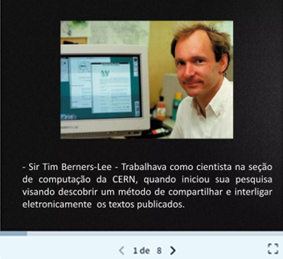
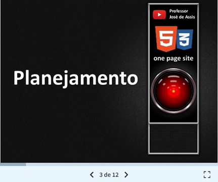
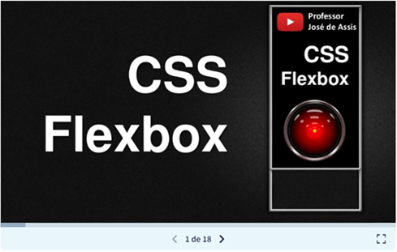

<!--  -->

    

# Site One Page
Este projeto foi desenvolvido como parte de um tutorial acompanhado passo a passo, com o objetivo de reforçar conceitos fundamentais de HTML5 e CSS3. Ao longo do processo, é construído um site completo no estilo one page: moderno, responsivo e estruturado de forma semântica. O conteúdo aborda desde a organização correta do HTML até a aplicação de estilos com CSS3, uso de cores, fontes, imagens, Flexbox, Media Queries e noções básicas de SEO.
É um material pensado para quem está iniciando ou deseja consolidar a base por meio da prática orientada.

Este repositório também hospeda o projeto final:

[html5css3.com.br](https://html5css3.com.br/)

### Autor
Professor José de Assis
### Apresentação do projeto

### Iniciar tutorial
▶️ [Playlist](https://www.youtube.com/playlist?list=PLbEOwbQR9lqySIIlPJ-Qwo4f4HSuXVeWk)

---
## Material de apoio
Aqui você encontra todos os recursos complementares deste tutorial: slides das aulas, links recomendados, códigos utilizados e materiais extras para aprofundar seus estudos. Tudo reunido em um só lugar para você acompanhar o curso com mais facilidade e aproveitar ao máximo cada etapa da construção do seu site!

### História do surgimento da internet

### História do HTML

### Primeiro site da internet
[Acessar](https://info.cern.ch/)
### Slides do tutorial
#### Planejamento

#### CSS FlexBox

## Links indicados:
### Planejamento
[cetic](https://www.cetic.br/)
### Wireframe
[draw](https://app.diagrams.net/)
### Personal designer
[matheus da costa](https://matheusdacosta.art.br/)
### Tipografia
[google fonts](https://fonts.google.com/)

[unicode](https://www.unicode.org/charts/)
### Imagens
[pixabay](https://pixabay.com/pt/)

[icon-icons](https://icon-icons.com/pt/)

[iconfinder](https://www.iconfinder.com/)

[optmizilla](https://imagecompressor.com/pt/)
### Validação W3C
[html](https://validator.w3.org/)

[css](https://jigsaw.w3.org/css-validator/)

---
### Certificado deste tutorial
🎓 [Iniciar teste](https://docs.google.com/forms/d/e/1FAIpQLSejGPKboMgEEKovik-yuKhmNeQdMfyny9gheiRnMzHKl9lajQ/viewform)

